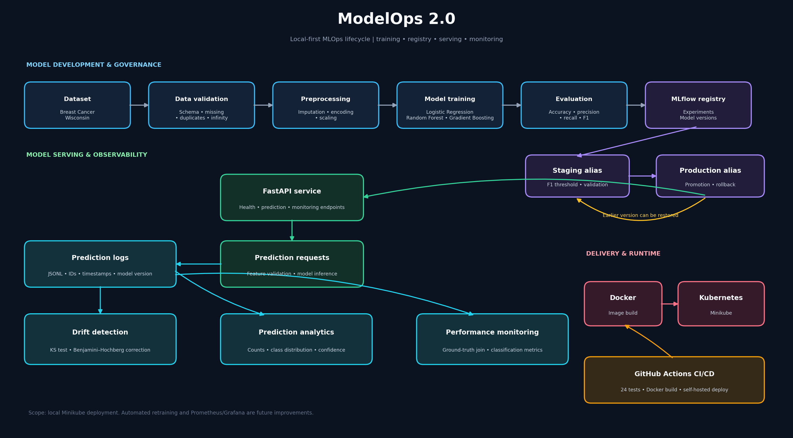

# ModelOps 2.0

### A Local-First MLOps Platform for Machine Learning Lifecycle Management

ModelOps is a hands-on MLOps platform designed to manage the machine learning lifecycle, from data validation and model training to experiment tracking, model versioning, deployment, monitoring, and rollback.

The project demonstrates how machine learning models can be managed and deployed using open-source tools and a local development environment.

## Architecture



## Key Features

- **Data Validation:** Checks datasets for missing values, duplicate records, infinite values, and schema issues.
- **ML Pipeline:** Automates preprocessing, training, and model evaluation.
- **Experiment Tracking:** Uses MLflow to track experiments, parameters, and metrics.
- **Model Registry:** Registers and versions trained models.
- **Model Promotion:** Supports staging and production aliases with validation checks.
- **Model Rollback:** Allows switching the production alias to an earlier model version.
- **REST API:** Serves predictions through FastAPI.
- **Drift Detection:** Uses statistical tests to identify changes in incoming prediction data.
- **Prediction Analytics:** Tracks prediction counts, distributions, model versions, and confidence.
- **Performance Monitoring:** Evaluates predictions against recorded ground-truth labels.
- **Containerization:** Packages the application using Docker.
- **Orchestration:** Deploys the application locally using Kubernetes and Minikube.
- **CI/CD:** Uses GitHub Actions for automated testing, Docker builds, and local Kubernetes deployment.

## Architecture

```text
             DATASET
                |
                v
         DATA VALIDATION
                |
                v
          PREPROCESSING
                |
                v
          MODEL TRAINING
                |
                v
        MODEL EVALUATION
                |
                v
        MLFLOW REGISTRY
                |
          +-----+-----+
          |           |
        STAGING    PRODUCTION
          |           |
          +-----+-----+
                |
                v
           FASTAPI
                |
                v
          PREDICTIONS
                |
       +--------+--------+
       |        |        |
       v        v        v
    ANALYTICS  DRIFT   PERFORMANCE
             DETECTION  MONITORING
                |
                v
         MODEL MANAGEMENT
          /          \
      PROMOTION     ROLLBACK

       DOCKER + KUBERNETES
                |
                v
           DEPLOYMENT

          GITHUB ACTIONS
                |
                v
           CI/CD PIPELINE
```

## Technology Stack

| Category | Technology |
|---|---|
| Programming Language | Python |
| Machine Learning | Scikit-learn |
| Data Processing | Pandas, NumPy |
| Experiment Tracking | MLflow |
| Backend API | FastAPI |
| API Server | Uvicorn |
| Containerization | Docker |
| Container Orchestration | Kubernetes |
| Local Kubernetes | Minikube |
| CI/CD | GitHub Actions |
| Testing | Pytest |
| Version Control | Git, GitHub |

## Project Structure

```text
ModelOps/
│
├── backend/
│   └── main.py
│
├── ml_pipeline/
│   ├── data_validation/
│   ├── preprocessing/
│   ├── training/
│   └── evaluation/
│
├── drift_detection/
│   ├── detect_drift.py
│   └── run_monitoring.py
│
├── monitoring/
│   ├── monitoring_service.py
│   ├── prediction_analytics.py
│   ├── performance_monitor.py
│   ├── reference_data/
│   ├── prediction_logs/
│   └── reports/
│
├── retraining/
│
├── infrastructure/
│   ├── docker/
│   └── kubernetes/
│
├── tests/
│
├── .github/
│   └── workflows/
│       ├── ci.yml
│       └── cd.yml
│
├── Dockerfile
├── docker-compose.yml
├── requirements.txt
└── README.md
```

## Getting Started

### Requirements

- Python 3.13
- Git
- Docker Desktop
- Docker Compose

### 1. Clone the repository

```bash
git clone https://github.com/Abhay-aiml/ModelOps.git
cd ModelOps
```

### 2. Create a virtual environment

Windows PowerShell:

```powershell
python -m venv .venv
.\.venv\Scripts\Activate.ps1
```

### 3. Install dependencies

```powershell
python -m pip install --upgrade pip
pip install -r requirements.txt
```

### 4. Run automated tests

```powershell
python -m pytest -v
```

### 5. Run the training pipeline

```powershell
python -m ml_pipeline.training.train
```

### 6. Start the API

```powershell
uvicorn backend.main:app --reload
```

API:

`http://127.0.0.1:8000`

Interactive API documentation:

`http://127.0.0.1:8000/docs`

### 7. Run with Docker Compose

```powershell
docker compose up --build -d
```

Stop the application:

```powershell
docker compose down
```

## API Endpoints

| Method | Endpoint | Purpose |
|---|---|---|
| GET | `/` | API information |
| GET |
